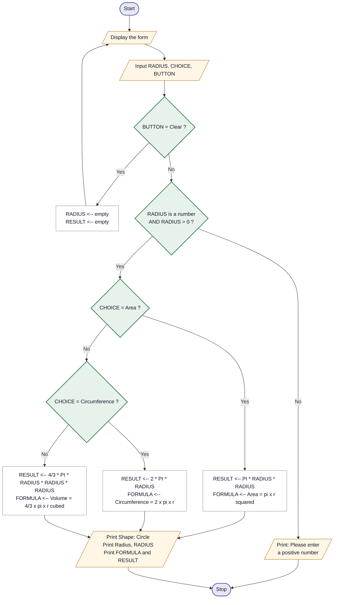

# PHP Exercises — Set I · The Circle Calculator

**Full worked solution: pseudocode, flowchart and PHP code.**

The sheet says *"write pseudocode and flowchart and PHP code"* — so there are three separate
deliverables here, and the marker reads them as three. Don't hand in only the code.

> **Type the PHP yourself, don't paste it.** You may well be asked to explain a line of it.
> Everything below is commented so you can.

**Related, but not the same thing:** the circle maths also appears as practice problems
**A** and **B** in `php-problems.html` (from the lecture deck — fixed radius, then radius
from a form). Those use `M_PI` and don't have the Calculate/Clear buttons or the
circumference. Do them first if you want a warm-up; this page is the actual assignment.

---

## What the question actually asks for

| The sheet says | Which means |
|---|---|
| An input field for radius | one `<input type="text" name="radius">` |
| Calculate button + Clear button | two submit buttons with **different `name`s** |
| *"identify which button was pressed"* | `isset($_POST["calculate"])` vs `isset($_POST["clear"])` ← **this is the real question** |
| Use the correct formula | pick based on which calculation was chosen |
| Display the formula used **and** the result | both, not just the number |
| `pi()` is predefined | never type `3.14159` yourself |

That third row is the point of the exercise. Everything else you already know.

---

## 1. Pseudocode

Written in **your lecturer's notation** — name on top, comment in square brackets, variables
in CAPITALS, `<--` for assignment, `if-then-else` / `endif`.

```
Algorithm CircleCalculator
[reads a radius and a chosen calculation, then prints the formula used and the result]

    Input RADIUS, CHOICE, BUTTON

    if (BUTTON = "Clear") then
        RADIUS  <-- empty
        RESULT  <-- empty
        Print "Enter the Radius:"
    else
        if (RADIUS is not a number) OR (RADIUS <= 0) then
            Print "Please enter a positive number"
        else
            if (CHOICE = "Area") then
                RESULT  <-- PI * RADIUS * RADIUS
                FORMULA <-- "Area = pi x r^2"
            else
                if (CHOICE = "Circumference") then
                    RESULT  <-- 2 * PI * RADIUS
                    FORMULA <-- "Circumference = 2 x pi x r"
                else
                    RESULT  <-- (4 / 3) * PI * RADIUS * RADIUS * RADIUS
                    FORMULA <-- "Volume = 4/3 x pi x r^3"
                endif
            endif

            Print "Shape: Circle"
            Print "Radius: ", RADIUS
            Print FORMULA, " = ", RESULT
        endif
    endif

End
```

**Two marks people lose here:**

1. **The arrow.** In pseudocode `<--` puts a value in and a single `=` *compares*.
   In PHP they swap: `=` puts in, `==` compares. Write `<--` on the paper.
2. **Every `if` needs its `endif`.** Three `if`s above, three `endif`s. Count them before
   you hand it in.

---

## 2. Flowchart



### Drawing it by hand

The colours above map to the four symbols your lesson gave you:

| Step | Shape to draw |
|---|---|
| Start, Stop | **oval** (terminal) |
| Display the form · Input · every Print | **parallelogram** (input/output) |
| `RESULT <-- ...` and the clearing step | **rectangle** (process) |
| The four questions with Yes/No coming out | **diamond** (decision) |
| Everything joining them | **arrows** |

**The two rules that cost marks, from your own notes:**

1. ✅ It has **a Start and a Stop**, both ovals. Mine does.
2. ✅ **Every step connects** — nothing dangling. Notice the three calculation boxes
   (`I`, `K`, `L`) all join back into the same Print box. That's deliberate: the three
   branches rejoin before the output, so there's only one Print block instead of three.

That rejoining is the bit markers like, because it shows you understood that the *printing*
is the same regardless of which formula ran.

---

## 3. The PHP code

Full working file: **[`circle.php`](circle.php)**

Run it at `http://localhost/fatoma/Php/assignments/set-1-circle/circle.php`
(Apache and MySQL started in XAMPP — Apache is enough for this one).

### The part the question is really about

```php
if ($_SERVER["REQUEST_METHOD"] === "POST") {

    if (isset($_POST["clear"])) {
        // the Clear button was pressed
    }
    elseif (isset($_POST["calculate"])) {
        // the Calculate button was pressed
    }
}
```

Why this works: a submit button is only sent to PHP **if it was the one clicked**. So giving
them different names —

```html
<button type="submit" name="calculate">Calculate</button>
<button type="submit" name="clear">Clear</button>
```

— means `$_POST["calculate"]` only exists when Calculate was pressed, and `$_POST["clear"]`
only when Clear was. `isset()` asks "does this key exist?", and that is how you tell them apart.

> If you give both buttons the same `name`, you can still tell them apart by their `value` —
> but different names is cleaner and it's what the question is pointing at.

### The three formulas

```php
$result = pi() * $r * $r;                   // Area          = π × r²
$result = 2 * pi() * $r;                    // Circumference = 2 × π × r
$result = (4 / 3) * pi() * $r * $r * $r;    // Volume        = 4/3 × π × r³
```

`pi()` is built into PHP and is far more accurate than typing `3.14`. The sheet mentions it
on purpose — using `3.14` instead would lose you a mark.

> ⚠️ **Write `(4 / 3)` with the brackets.** `4 / 3 * pi() * $r * $r * $r` happens to give the
> same answer here because `*` and `/` run left to right — but the brackets say what you
> meant, and on a different formula the habit will save you.

### Validation — the marks nobody expects

```php
if ($radius === "")            $error = "Please enter the radius.";
elseif (!is_numeric($radius))  $error = "The radius has to be a number.";
elseif ($radius <= 0)          $error = "The radius has to be bigger than zero.";
```

The sheet doesn't ask for this. Include it anyway — "what happens if the user types *abc*"
is the first thing a marker tries, and a page that crashes looks unfinished.

### Showing the formula *and* the result

The sheet asks for both. That's why the code keeps a `$formula` string next to `$result`:

```php
$result  = pi() * $r * $r;
$formula = "Area = &pi; &times; r&sup2;";
...
echo $formula . " = " . round($result, 2);
```

`&pi;` `&times;` `&sup2;` are HTML entities — they print **π × r²** properly in the browser
instead of a plain `pi x r^2`.

---

## Checking it works

Enter **5** and the three answers are:

| Choice | Rounded | Exact |
|---|---|---|
| Area | `78.54` | `78.539816339745` |
| Circumference | `31.42` | `31.415926535898` |
| Volume | `523.6` | `523.5987755983` |

**Those exact numbers are the ones printed on your assignment sheet**, so if you get them,
your formulas are right. (I tested all three against real PHP — they match to the last digit.)

Also test: a blank box, the word `abc`, a negative number, and the **Clear** button. All four
should behave sensibly and none should produce a PHP error.

---

## If your lecturer wanted all three shown at once

The picture at the top of your sheet shows Area, Circumference **and** Volume together, while
the Example Output at the bottom shows only Area. The sheet is a little inconsistent.

My version uses radio buttons so you pick one — that matches *"Display the **selected**
result"* and the Example Output. If you'd rather show all three, delete the radio buttons and
replace the calculation block with:

```php
$area = pi() * $r * $r;
$circ = 2 * pi() * $r;
$vol  = (4 / 3) * pi() * $r * $r * $r;
```

then print all three lines. The pseudocode and flowchart would lose their `CHOICE` decisions
and become a straight line — which is simpler to draw, if you're short on time.

**Ask your lecturer which one he wants** before you hand it in. It's a one-line question and
it decides how much drawing you do.

---

## Hand-in checklist

- [ ] Pseudocode written out, with `<--` arrows and matching `endif`s
- [ ] Flowchart drawn with the right shapes, a Start **and** a Stop, nothing dangling
- [ ] `circle.php` runs with no errors
- [ ] Radius 5 gives 78.54 / 31.42 / 523.6
- [ ] Blank, `abc` and negative input all show a message instead of crashing
- [ ] Clear button empties the form
- [ ] You can explain what `isset($_POST["calculate"])` does out loud
